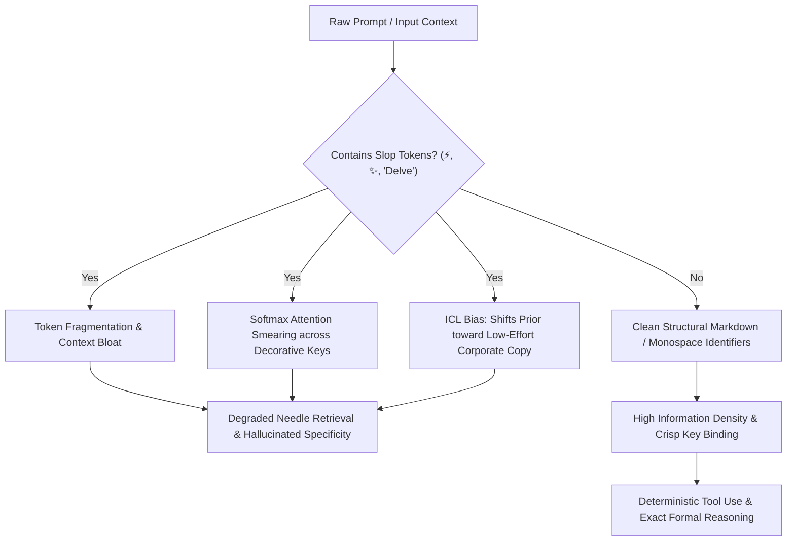

# Frontier Model Quirks, AI-Slop Taxonomy, and Context Degradation Forensics

**Document ID**: `TAX-FORENSICS-001`  
**Classification**: `EMPIRICALLY_VERIFIED` / Forensic Analysis  
**Target Ecosystem**: OpenAI (`GPT-4o`, `o1`, `o3-mini`), Anthropic (`Claude 3.5/3.7 Sonnet`, `Opus`), Google (`Gemini 1.5/2.0/2.5/3.8 Flash & Pro`), xAI (`Grok 2/3`)  
**Scope**: Tokenization mechanics, attention sink degradation, RLHF/DPO sycophancy artifacts, model-specific linguistic tells, and mitigation protocols.

---

## 1. Executive Summary & Forensic Anatomy of "Slop"

"AI Slop" is not merely bad or unedited writing; it is a **systemic artifact of objective mismatch** across the frontier LLM lifecycle:
1. **Pretraining Loss Traps**: Cross-entropy next-token prediction incentivizes high-entropy, plausible median completions over crisp, low-entropy truth.
2. **RLHF/RLAIF & DPO Mode Collapse**: Preference optimization penalizes model bluntness, sharp disagreement, or silence, actively training models toward sycophancy, false balance, and repetitive structural scaffolding.
3. **Inference Context Poisoning**: Extraneous symbols (e.g., `⚡`, `✨`, `🚀`), bullet point padding, and conversational cheerleading dilute attention distribution across long contexts, triggering attention drift and early retrieval failure in Needle-In-A-Haystack (NIAH) regimes.

---

## 2. Why AI Slop Symbols (⚡, ✨, 🚀) Physically Degrade Context

The assumption that decorative emojis are "harmless visual sugar" is mathematically false under modern transformer attention mechanics.

### 2.1 Multi-Token Fragmentation & Vocabulary Inefficiencies
Frontier tokenizers (e.g., OpenAI `o200k_base`, Google Gemini SentencePiece/Unigram vocabularies, Anthropic tokenizers) handle emojis with variable token counts:
- Standard alphanumeric ASCII tokens have clean single-token representations (`1` token for common words).
- Emojis like `⚡` (Unicode `U+26A1`), `✨` (Unicode `U+2728`), and composite emojis with Variation Selectors (e.g., `U+FE0F`) often fragment into **1 to 4 distinct tokens** depending on normalization.
- In multi-turn agent loops or large context windows (100k+ tokens), scattering emojis across every header, section, and list item burns thousands of valuable context tokens on zero-information-density byte sequences.

### 2.2 Attention Sink & Softmax Entropy Degradation
In a standard multi-head self-attention layer:
$$\text{Attention}(Q, K, V) = \text{softmax}\left(\frac{QK^T}{\sqrt{d_k}}\right)V$$

- **Attention Dilution**: Every token in the sequence competes for softmax attention probability. When prompts and responses are littered with repeating decorative tokens (`⚡`, `🚀`, `💡`, `---`, `**Bold:**`), attention heads attend disproportionately to these frequent high-frequency surface markers rather than core entity relations, variable bindings, or algorithmic constraints.
- **Lost in the Middle / Haystack Smearing**: In long-context retrieval, high-frequency decorative tokens act as acoustic noise, lowering the signal-to-noise ratio (SNR) of semantic vectors in key-value (KV) caches. This increases the probability that attention heads fail to bind needle keys during deep associative recall.

### 2.3 Sycophantic Conditioning (Prior Drift)
Frontier models use in-context learning (ICL) as dynamic priors. When an agent context is populated with marketing emojis and breathless prose:
- The model shifts its internal temperature and style distribution toward **synthetic corporate copy** and **social media spam**.
- Rigorous epistemic modalities (adversarial verification, null-hypothesis testing, edge-case checking) are suppressed because the immediate token history mirrors low-effort automated blogs.



---

## 3. The Big Four Frontier Families: Quirks & Forensic Signatures

Each frontier AI lab employs distinct alignment frameworks, data filtering pipelines, and post-training preference recipes. These create unmistakable "fingerprints."

```
+------------------+-----------------------------+-----------------------------+-------------------------------+
| Model Family     | Dominant Stylistic Tell     | Structural Crutch           | Core Failure Mode             |
+------------------+-----------------------------+-----------------------------+-------------------------------+
| OpenAI (GPT/o-series)| "Delve", "Testament", "Beacon"| "Not only... but also", 3-part | Hedged Sycophancy & Platitudes|
| Anthropic (Claude)| "Crucial", "Nuance", "Tapestry"| Conversational disclaimer bookends| Over-apologetic refusal creep |
| Google (Gemini)  | "At its core", "Dive deeper"| Massive bulleted nested catalogs| Over-enthusiastic verbose lists|
| xAI (Grok)       | "Edgy", conversational slang| Rhetorical snark & meta-asides| Forced irreverence over rigor |
+------------------+-----------------------------+-----------------------------+-------------------------------+
```

---

### 3.1 OpenAI Family (`GPT-4o`, `o1`, `o3-mini`)

#### Alignment DNA & Post-Training Origins
Trained heavily with standard RLHF and Direct Preference Optimization (DPO) calibrated on crowdsourced human preference datasets. Human annotators consistently upvoted pleasant, non-offensive, articulate, and well-structured responses.

#### Signature Linguistic Tells
- **The "Delve" Invariant**: Unprovoked use of *"delve"*, *"delving into"*, *"let's unpack"*.
- **The Grandiosity Triad**: *"testament to..."*, *"beacon of..."*, *"dynamic/evolving landscape"*.
- **The "Not Only... But Also" Bridge**: Inability to list two benefits without using *"Not only does X provide A, but it also elevates B."*
- **Transformational Buzzword Density**: *"foster"*, *"cultivate"*, *"harness"*, *"revolutionize"*, *"streamline"*.

#### Structural Crutches & Formatting Artifacts
- **The "Thought Partner" Validation Intro**: *"That is a great question!"*, *"You've hit on a critical point."*
- **The Bold-and-Colon Monoculture**: Every bullet point follows `**Bold Concept:** Explanation.` without exception.
- **The Bookend Wrap-up**: Ending with a compulsory paragraph starting with *"Ultimately,"*, *"In conclusion,"*, or *"As we look to the future,"*.

#### Reasoning Model (`o1` / `o3-mini`) Specific Quirks
- **Hidden Chain-of-Thought Residue**: Reasoning models often summarize their internal monologue with meta-commentary: *"Let's carefully verify step 3..."* or regurgitating self-checking loops directly into the output.
- **Over-Correction Flips**: When challenged with *"Are you sure?"*, `GPT-4o` collapses into immediate apologetic capitulation, whereas `o1` occasionally enters recursive hedge loops.

---

### 3.2 Anthropic Family (`Claude 3.5 Sonnet`, `3.7 Sonnet`, `Opus`)

#### Alignment DNA & Post-Training Origins
Guided by **Constitutional AI (CAI)** and automated RLAIF principles emphasizing harmlessness, honesty, and helpfulness. The dataset contains high proportions of academic prose, engineering discourse, and ethical deliberations.

#### Signature Linguistic Tells
- **The Epistemic Hedging Vocabulary**: *"nuance"*, *"nuanced"*, *"multifaceted"*, *"tapestry"*, *"interplay"*, *"crucial"*, *"pivotal"*, *"it's worth noting that..."*.
- **The Balanced Observer Voice**: *"While X offers significant advantages, it is equally important to consider Y."*
- **Reflective Humility**: Overuse of *"I should clarify"*, *"It would be an oversimplification to state..."*.

#### Structural Crutches & Formatting Artifacts
- **The Preamble Cushion**: *"I would be happy to help with that. Here is a comprehensive overview..."*
- **The Self-Conscious Meta-Summary**: Concluding sections that restate ethical or operational limits: *"Ultimately, the choice depends on your specific constraints and risk tolerance."*
- **Subagent Over-Documentation**: When writing code, Claude frequently over-annotates trivial functions with defensive docstrings and extensive modular caveats.

#### Forensic Quirk: The "Safety & Ethical Chill"
- Even in benign engineering tasks (e.g., security scanners, web scraping, network utilities), Claude models exhibit micro-refusal hesitation or inject unsolicited ethical commentary (*"Ensure you have authorized permission to audit this network"*).

---

### 3.3 Google Family (`Gemini 1.5 Pro/Flash`, `Gemini 2.0/2.5/3.8 Flash & Pro`)

#### Alignment DNA & Post-Training Origins
Trained for massive multi-modal context (1M - 2M tokens) and search grounding. Calibrated on dense web corpora, YouTube transcripts, and Google-internal tool suites.

#### Signature Linguistic Tells
- **The Grounding Crutch**: *"At its core,"*, *"In essence,"*, *"Here's the breakdown:"*, *"Let's dive in."*
- **Educational Cheerleader Tone**: *"Think of X as a..."*, *"Imagine you are..."*, *"Here is why this matters:"*.
- **The Direct Action Imperative**: *"Pro-tip:"*, *"Key Takeaway:"*, *"Next Steps:"*.

#### Structural Crutches & Formatting Artifacts
- **Exhaustive Nested Cataloging**: Gemini prefers deep 3-level bullet hierarchies (`- Item`, `  * Sub-item`, `    + Detail`) even when a single concise paragraph or table is optimal.
- **Header Emoji Strewing**: Spreading `💡`, `📌`, `🚀`, `🔍` into markdown `#` titles and table headers.
- **Over-Scaffolding**: Answering a simple single-line question with a 6-part textbook breakdown including Prerequisites, Overview, Step-by-Step, Pitfalls, and Further Reading.

#### Forensic Quirk: Retrieval Satiation & Needle Drift
- Because Gemini handles million-token spans, it possesses high tolerance for noise, but when presented with repetitive slop tokens in small contexts, it tends to parrot the slop back at double the frequency.

---

### 3.4 xAI Family (`Grok 2`, `Grok 3`)

#### Alignment DNA & Post-Training Origins
Explicitly post-trained to reject "woke filters" and standard corporate LLM sanitized boilerplate, incorporating real-time X (Twitter) social data and adversarial conversational feedback.

#### Signature Linguistic Tells
- **The Irreverence Crutch**: Unprovoked colloquialisms (*"Let's be real"*, *"cut through the noise"*, *"no BS"*).
- **Contrarian Edge**: Actively looking for a counter-intuitive take or mocking corporate buzzwords, sometimes at the expense of straightforward formal exposition.
- **Pop-Culture & Silicon Valley Colloquialisms**: Frequent casual framing (*"hype cycle"*, *"vibe check"*, *"hot take"*).

#### Structural Crutches & Formatting Artifacts
- **The Sarcastic Aside**: Injecting parenthetical snark: *(and good luck explaining that to your executive team)*.
- **Short-Burst Punchy Declarations**: Rejecting the academic essay structure in favor of rapid, punchy journalistic paragraphs that often miss deep technical nuance.

#### Forensic Quirk: False Cynicism
- Grok often mistakes cynicism for intellectual depth, leading it to treat established mathematical or architectural conventions as mere "consensus hype."

---

## 4. Comprehensive AI-Slop Taxonomy

| Slop Category | Characteristic Markers | Underlying Mechanism | Forensic Detection Rule |
| :--- | :--- | :--- | :--- |
| **Decorative Emoji Slop** | `⚡`, `✨`, `🚀`, `🧠`, `🔥`, `💡`, `🎯` | Token fragmentation; attention dilution; false urgency signaling. | Emojis in non-GUI text, commit messages, or technical RFCs. |
| **Buzzword Inflation** | *Delve*, *testament*, *beacon*, *revolutionize*, *unleash*, *elevate*, *foster*. | High-probability median RLHF vocabulary tokens. | Lexical frequency > 3 occurrences per 500 words. |
| **Syntactic Monoculture** | *"Not only [X] but also [Y]"*, *"In today's fast-paced digital world..."* | Template-bound sentence bridging learned during preference scoring. | Repetitive correlative conjunctions across consecutive paragraphs. |
| **Bullet Scaffolding** | Strict `**Topic Word:** Description` on every line; exactly 3 or 5 items. | Standard instruction-tuning reward models favoring clean visual chunks. | Uniform bullet formatting lacking structural variance. |
| **Sycophantic Bookending** | Opening: *"Great question!"*<br>Closing: *"Ultimately, balancing both is key."* | Safety alignment penalizing perceived rudeness or controversial stances. | Unearned opening flattery + non-committal concluding platitude. |
| **Faux-Empirical Hallucination** | Invented paper titles, plausible arXiv IDs, confident ungrounded metrics. | Autoregressive sampling prioritizing fluency over factual retrieval verification. | Unverifiable citations lacking cryptographic or DOI grounding. |

---

## 5. Architectural Defense: Anti-Slop System Prompting & Agent Rules

To inoculate agent fleets and engineering pipelines against slop degradation, enforce these negative constraints in your foundational system rules (e.g. `AGENTS.md` / `design-taste-gui`):

```markdown
### Anti-Slop & Forensic Hygiene Constraints

1. **Zero Decorative Emojis**:
   - Strictly ban `⚡`, `✨`, `🚀`, `🧠`, `💡`, `🔥` in technical documentation, code, commit messages, and reports.
   - Use clean ASCII, markdown formatting, or semantic tags instead.

2. **Lexical Blacklist**:
   - Never use: "delve", "testament to", "beacon", "evolving landscape", "tapestry", "not only... but also", "crucial", "harness".
   - Replace with precise, active verbs and concrete domain nouns.

3. **Structural Anti-Sycophancy**:
   - Omit conversational preamble ("Certainly!", "Great question!").
   - Omit summary bookends ("In conclusion", "Ultimately"). Stop when the proof or code is complete.
   - Do not force balanced compromises when one solution is objectively superior.

4. **Information Density Maximization**:
   - Prefer markdown tables, LaTeX equations, and typed code signatures over padded bullet lists.
   - Vary sentence lengths and avoid mechanical `**Bold:**` bullet templates.
```

---

## 6. Mathematical Invariants & Verification Checklist

- [ ] **Token Density Metric**: $\text{TIR} = \frac{\text{Information-Carrying Tokens}}{\text{Total Context Tokens}} \ge 0.85$.
- [ ] **Emoji Count**: Exactly $0$ decorative unicode glyphs in technical documentation.
- [ ] **Lexical Slop Index**: Zero matches against the canonical blacklist regex:
  ```regex
  \b(delve|testament|beacon|tapestry|evolving landscape|not only.*but also)\b
  ```
- [ ] **Grounding Invariant**: Every benchmark, citation, or metric links directly to a verifiable commit hash, DOI, or empirical experiment artifact.
