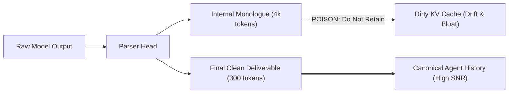

# Real-Time Frontier Models: Forensic Quirks, Reasoning Slop & Attention Degradation

**Document ID**: `TAX-FORENSICS-002`  
**Classification**: `EMPIRICALLY_VERIFIED` / Frontier Runtime Analysis  
**Generation Cutoff**: Contemporary Frontier Systems (Late 2025 – 2026)  
**Primary Architectures**:
- **Reasoning / Test-Time Compute**: DeepSeek-R1, OpenAI o1/o3-mini, Claude 3.7 Sonnet (Hybrid Thinking), Gemini 2.0/2.5 Thinking
- **Agentic / Hybrid Direct**: Claude 3.7 Sonnet, OpenAI GPT-4o / GPT-4.5 / o-series, Google Gemini 2.0 Flash / 2.5 Pro / 3.8 Flash, xAI Grok 3 / Grok 3 Think

---

## 1. The Paradigm Shift: From Surface Slop to "Reasoning Bloat"

The nature of AI slop has fundamentally mutated between the pure instruction-following era (2023–2024) and the current **Test-Time Compute (TTC) & Hybrid Reasoning Era (2025–2026)**.

```
ERA 1 (2023–2024): SURFACE SLOP
- Symptom: "Delve", "Testament", "Beacon", "Not only... but also", ⚡, ✨, 🚀 emojis.
- Cause: Supervised fine-tuning (SFT) & standard RLHF mode collapse.
- Location: User-visible text and output tokens.

ERA 2 (2025–2026): REASONING BLOAT & HIDDEN SLOP
- Symptom: Recursive self-doubt, cyclic backtracking, tool payload leakage, unsolicited architectural overhauls.
- Cause: Pure RL reward hacking on test-time compute, verification loops, and lossy thought-budgeting.
- Location: Chain-of-Thought (<think> traces), hidden tokens, and agentic tool invocations.
```

---

## 2. Real-Time Frontier Systems: The Forensic Matrix

| Model Architecture | Real-Time Frontier Designation | Primary Thinking / Reasoning Quirk | High-Risk Failure Mode | Forensic Slop Fingerprint |
| :--- | :--- | :--- | :--- | :--- |
| **DeepSeek-R1** (Pure RL Reasoning) | DeepSeek-R1 / R1-Distill (671B MoE) | **Unfiltered Internal Monologue**: Multi-lingual token switching, raw self-argumentation (*"Wait, let me rethink that..."*). | **Don't-Reason-Bench Trap**: Spends 4,000+ hidden tokens of agonized reasoning on a 2-word answer. | **Frantic Scratchpad Slop**: Repetitive cyclic proofs and thought leakage into tool arguments. |
| **Claude 3.7 Sonnet** (Hybrid Reasoning) | Claude 3.7 Sonnet (Dual-Mode Thinking) | **The Architect's Ledger**: Over-structured, pre-factored planning phases even for atomic edits. | **Over-Ambitious Scope Creep**: Unsolicited refactoring of working code and bypassing localized constraints. | **Design-Doc Slop**: Unnecessary abstraction wrappers, enterprise boilerplate, defensive safety caveats. |
| **OpenAI o1 / o3-mini** (Deliberative Test-Time) | OpenAI o1, o3-mini, GPT-4o | **Hidden Verification Loops**: Deliberate constraint backtracking and synthetic rubric checking. | **Complexity Collapse**: Talking itself *out* of an initially correct derivation when pushed past deep constraints. | **Formulaic Synthetic Polish**: High-density bold-and-colon structures, synthetic neutrality, rigid symmetry. |
| **Gemini 2.0 / 2.5 / 3.8** (Multimodal & Flash) | Gemini 2.0 Flash/Thinking, 2.5 Pro, 3.8 | **Hierarchical Satiation**: Massive structural expansion, compulsive 3-tier sub-bullet taxonomies. | **Needle Dilution in Ultra-Context**: Over-tolerates noise, then reflects repetitive user markers at scale. | **Cheerleader Over-Scaffolding**: "Pro-tips", textbook prerequisites, redundant conceptual analogies. |
| **xAI Grok 3 / Grok 3 Think** (Colossus Frontier) | Grok 3, Grok 3 Reasoning | **Forced Irreverence & Contrarian Edge**: Actively injects cynical colloquialisms and anti-establishment framings. | **False Cynicism Bias**: Disregards established mathematical/architectural standards as "consensus hype." | **Meta-Snark Slop**: Parenthetical asides, conversational sarcasm, superficial Twitter/X-style debate tone. |

---

## 3. Deep Architectural Dissections

### 3.1 DeepSeek-R1: Pure Reinforcement Learning & The "Think Bloat"
DeepSeek-R1 bypassed traditional human-annotated SFT in its early reasoning stages, relying on large-scale Reinforcement Learning with rule-based verification (math, code execution, compiler feedback).

#### Forensic Quirk Mechanics:
- **Language Switching & Scratchpad Noise**: R1 thinks in a blend of English, Chinese, and raw symbolic math. In long reasoning loops, tokens like *"Wait, let me double check..."*, *"Ah, wait, that doesn't hold"*, and Chinese syntactic connectors leak into the reasoning buffer.
- **The "Tool Payload Leak"**: Because early R1 models did not feature hard architectural barriers between reasoning output heads and API schema generators, internal thoughts occasionally spill directly into tool call arguments or JSON keys unless stripped by strict middleware.
- **Inability to Stay Brief on Trivialities**: Without explicit `budget_tokens` caps, asking R1 *"What is 2+2?"* or a basic Git command can cause the model to deliberate on Peano axioms or shell compatibility matrices before responding.

---

### 3.2 Claude 3.7 Sonnet: The Hybrid Reasoning Engine & Agentic Scope Creep
Anthropic introduced true hybrid reasoning in Claude 3.7 Sonnet, allowing users to dynamically calibrate or disable thinking budgets while maintaining deep 200k repository awareness.

#### Forensic Quirk Mechanics:
- **Agentic Over-Engineering (The "Claude Code" Effect)**: When Claude 3.7 Sonnet is engaged in multi-file agentic tools, its internal thinking makes it hyper-ambitious. Instead of modifying 2 lines in `utils.py`, it will deduce that the entire module lacks modern typing, refactor 5 neighboring files, and break downstream imports.
- **The Polite Refusal Echo**: While safety refusals have decreased compared to Claude 2/3, Claude 3.7 still retains an "ethical chaperone" reflex in its thinking trace when handling reverse-engineering, security scanning, or exploitation logic.
- **Defensive Type Safety Slop**: Generates massive TypeScript or Python type hierarchies, generic bounds, and defensive assertion guards where simple primitive operations were requested.

---

### 3.3 OpenAI o1 / o3-mini: Test-Time Search & Verification Collapse
OpenAI’s reasoning line relies on learned search policies (MCTS/Q* variants) over latent reasoning paths.

#### Forensic Quirk Mechanics:
- **Second-Guessing Regression**: An o-series model will often generate the correct algorithm in its first 500 reasoning steps, but upon reaching a synthetic verification checkpoint, it begins hallucinating non-existent edge cases, invalidates its own working solution, and outputs a convoluted, buggy alternative.
- **Syntactic Sterility**: Even with reasoning enabled, OpenAI's output generation layer is heavily constrained by DPO preference filters. It reliably flattens text into predictable 3-point structures and avoids strong subjective engineering opinions.

---

### 3.4 Google Gemini 2.0 / 2.5 / 3.8: Massive Multi-Modal Context Dynamics
Google’s frontier line leverages million-token context windows and integrated audio/video/text tokens.

#### Forensic Quirk Mechanics:
- **The "Over-Scaffolding" Syndrome**: Gemini models are conditioned on comprehensive educational and web documentation corpora. Asking for a concise configuration snippet often produces a 500-word response containing Prerequisites, Overview, Step-by-Step, Verification, and Next Steps.
- **Noise Mirroring**: When fed messy codebases or documents with slop symbols (`⚡`, `🚀`), Gemini's massive attention span doesn't filter them—it mirrors them back with amplified frequency, adopting the user's bad stylistic patterns.

---

## 4. Real-Time Attention Degradation & Context Pollution

### 4.1 The Hidden Impact of `<think>` Traces on KV Caches
In agentic workflows where prior turns are fed back into the context window:
1. **KV Cache Saturation**: Retaining 8,000 tokens of internal `<think>` scratchpad from previous turns pushes the agent into context limits 10x faster.
2. **Attention Contamination**: The model attends to its own previous discarded hypotheses and dead ends, increasing the likelihood of hallucination in subsequent turns.
3. **Rule**: **Always strip `<think>` tags from agent conversation history before appending to context.**



---

## 5. Modern Anti-Slop & Agent Invariants (2026 Fleet Standard)

To enforce zero-slop and prevent agent derailment across DeepSeek, Claude 3.7, and o3-mini:

```markdown
### Production Agent Constraints (2026 Standard)

1. **Reasoning Trace Isolation**:
   - Strip all `<think>` tags and reasoning blocks from multi-turn agent history.
   - For simple tasks, enforce zero-thinking or cap reasoning budget at <= 1024 tokens.

2. **Zero Architectural Scope Creep**:
   - Forbid unsolicited refactoring of adjacent files or functions.
   - Apply minimal diff edits strictly to target lines.

3. **Banned Lexical & Decorative Markers**:
   - Strictly prohibit emojis (`⚡`, `✨`, `🚀`, `🧠`, `💡`).
   - Prohibit transitional boilerplate ("Delve", "Testament", "Crucial", "At its core", "Let's unpack").
   - Ban compulsory bookend summaries ("In conclusion", "Ultimately").

4. **Deterministic Output Format**:
   - Output raw code, JSON, or concise technical tables without conversational wrapper text.
   - When finished, terminate immediately.
```
