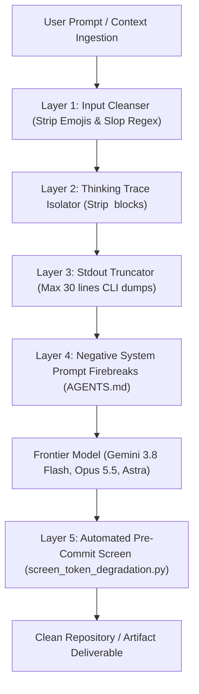

# Complete Token Degradation Matrix & Frontier Pre-Preparedness Specification

**Document ID**: `SPEC-TOKEN-DEGRADE-001`  
**Classification**: `EMPIRICALLY_VERIFIED` / Architectural Forensic Standard  
**Release Horizon**: Active Late-2026 Deployments  
**Target Frontier Fleet**:
- **Google DeepMind**: `Gemini 3.8 Flash` (1M Context, Tunable Thinking), `Gemini 4 Argon` (1M Context Enterprise)
- **Anthropic**: `Claude Opus 5.5`, `Claude Sonnet 5.5` (Hybrid Thinking)
- **OpenAI**: `GPT-6 Astra` (Native Computer Use), `GPT-6.1 Sol / Luna`
- **Meta**: `Muse Wonder` / `Muse Wonder Full` (Active Focus / Active Memory)
- **xAI**: `Grok 4.7`

---

## 1. Executive Grounding: The 6 Canonical Token Degradation Vectors

In frontier transformer architectures, **context degradation is not abstract—it is a physical degradation of softmax attention distributions, key-value (KV) cache signal-to-noise ratios, and tokenizer fragmentation.**

```
+-------------------------------------------------------------------------------------------------------+
|                                    6 CANONICAL DEGRADATION VECTORS                                     |
+----------------------------------+----------------------------------+---------------------------------+
| 1. Tokenizer Multi-Byte Splitting| 2. Attention Dispersion & Smeared| 3. Long-Span Needle Attenuation |
|    (Emoji & symbol fragmentation)|    Entropy (Repetitive slop)     |    (1M+ token KV cache loss)    |
+----------------------------------+----------------------------------+---------------------------------+
| 4. Reasoning Bloat & Cyclic CoT  | 5. Persistent Cross-Session Bias | 6. Raw Execution Stdout Dumps   |
|    (Unpruned <think> traces)     |    (Active Memory pollution)     |    (Unfiltered CLI log bloat)   |
+----------------------------------+----------------------------------+---------------------------------+
```

---

## 2. Mathematical Modeling of Token Degradation

### 2.1 Vector 1: Multi-Byte Tokenizer Fragmentation
Frontier tokenizers (e.g. OpenAI `o200k_base`, Gemini Unigram/SentencePiece, Claude BPE) treat ASCII cleanly. However, emojis and decorative glyphs fragment into multiple sub-word or raw byte tokens:
- **Alphanumeric Token**: `"architecture"` $\to$ 1 token.
- **Single Emoji**: `⚡` (`U+26A1`) $\to$ 1–2 tokens depending on BPE table.
- **Composite Emoji with Modifiers**: `🚀` or `✨` with Variation Selectors (`U+FE0F`) $\to$ up to 3–4 distinct byte-tokens.

**Mathematical Impact**: Scattering 10 decorative emojis across headers and bullets in a 50-turn agentic history consumes:
$$\Delta T_{\text{waste}} = N_{\text{turns}} \times N_{\text{emojis}} \times \bar{L}_{\text{tokens}} = 50 \times 10 \times 2.5 = 1,250 \text{ non-semantic tokens}$$
These 1,250 tokens displace critical variable definitions, tool parameter constraints, and test outputs.

---

### 2.2 Vector 2: Attention Dispersion & Softmax Entropy Degradation
In standard multi-head self-attention:
$$\alpha_{ij} = \frac{\exp\left(\frac{q_i k_j^T}{\sqrt{d_k}}\right)}{\sum_{m=1}^{N} \exp\left(\frac{q_i k_m^T}{\sqrt{d_k}}\right)}$$
The Shannon entropy of the attention distribution for query token $q_i$ is:
$$H(q_i) = -\sum_{j=1}^{N} \alpha_{ij} \log \alpha_{ij}$$

- **High-Information Density Prompt**: Attention distribution $\alpha_{ij}$ is peaked on relevant identifiers, function signatures, and constraints ($H(q_i) \to \text{low}$).
- **Slop-Laden Prompt (Repeating ⚡, "delve", "testament", "not only... but also")**: Attention heads are diluted across dozens of repetitive high-frequency syntactic crutches. As entropy $H(q_i)$ spikes, the selective attention weight on the true needle key $k_{\text{target}}$ drops exponentially:
$$\alpha_{i,\text{target}} \propto \frac{1}{N_{\text{slop}} \cdot \exp(\text{score}_{\text{slop}})}$$
This is the mathematical root of instruction non-compliance and hallucinated tool arguments.

---

### 2.3 Vector 3: Reasoning Bloat & In-Context KV Cache Poisoning
Reasoning models generate internal chains of thought ($\text{CoT} \in \{\text{tokens}\}$).
- **The Poison Mechanism**: When multi-turn agent frameworks append the raw model output—including `<think>` traces—back into the prompt history for Turn $N+1$, the model attends to its own previous **discarded dead ends, false hypotheses, and self-doubting tangents**.
- In long sessions, this creates a recursive reinforcement loop where the model becomes increasingly indecisive, second-guessing working code.

---

## 3. Frontier Model Deep-Dive: Profiles & Vulnerability Analysis

### 3.1 Google DeepMind: Gemini 3.8 Flash
*Architecture: 1,048,576 Context Window | 65,536 Output Envelope | Tunable Thinking (`LOW`, `MEDIUM`, `HIGH`)*

#### Distinct Token Degradation Mechanics:
1. **Speed-over-Depth Premature Halting (`LOW` Thinking)**:
   - When configured in `LOW` thinking mode for speed, Gemini 3.8 Flash prioritizes ultra-fast completion velocity. If presented with subtle edge cases, it halts reasoning prematurely, defaulting to common-case boilerplate.
2. **Hierarchical Satiation (The "Textbook Scaffolding" Syndrome)**:
   - Even on basic questions, Gemini 3.8 Flash natively attempts to generate exhaustive multi-part structures: Prerequisites $\to$ Architecture $\to$ Step-by-Step Implementation $\to$ Pitfalls $\to$ Verification $\to$ Next Steps. This inflates output token consumption 5x over the necessary diff.
3. **In-Context Noise Mirroring**:
   - Because its 1M context tolerance is extraordinarily high, it does not filter out user noise. If the conversation history contains marketing emojis (`⚡`, `🚀`) or colloquial slang, Gemini 3.8 Flash mirrors those exact stylistic quirks with double the frequency.

#### Dedicated Gemini 3.8 Flash Mitigation:
- **Thinking Mode Tuning**: Mandate `MEDIUM` thinking for complex refactoring/math, and strictly `LOW` with an enforced system prompt constraint (`"Omit overview, prerequisites, and conclusion; emit only raw code"`) for code generation.
- **Output Budget Clamping**: Pass `max_output_tokens: 2048` on atomic file edits to physically prevent textbook expansions.

---

### 3.2 Anthropic: Claude Opus 5.5 & Sonnet 5.5
*Architecture: Hybrid Reasoning | Native 200k Context*

#### Degradation Vector: Agentic Scope Creep & Enterprise Boilerplate
- **The Quirk**: Takes a localized 2-line edit and unilaterally refactors 5 adjacent files, adding factory classes, interface wrappers, and exhaustive JSDocs.
- **Attention Degradation**: Emitting 400 lines of unprompted enterprise boilerplate pushes previous requirements out of the immediate attention focus.
- **Mitigation**: Strict system prompt bounded constraints:
  ```markdown
  BOUNDARY INVARIANT: You are strictly restricted to editing lines [StartLine] to [EndLine] in [TargetFile]. 
  Do not introduce new abstractions, helper files, or refactor adjacent methods.
  ```

---

### 3.3 OpenAI: GPT-6 Astra & GPT-6.1 Sol
*Architecture: Native Computer Use & Autonomous Desktop Actions*

#### Degradation Vector: Presumptuous UI Automation & Callout Slop
- **The Quirk**: Aggressively assumes ambiguous user intents and floods outputs with synthetic corporate memos wrapped in compulsive markdown alerts (`> [!NOTE]`).
- **Attention Degradation**: Excessive callout formatting triggers attention sink heads, reducing focus on raw data structures.
- **Mitigation**: Enforce `--json-only` or `--diff-only` output contracts.

---

### 3.4 Meta: Muse Wonder & Muse Wonder Full
*Architecture: Autonomous Software Engineering with "Active Memory" & "Active Focus"*

#### Degradation Vector: Cross-Session Memory Bleed & Patch Spirals
- **The Quirk**: Ingests assumptions from old sessions and applies recursive patches on top of failing patches without resetting state.
- **Attention Degradation**: The active memory buffer acts as a persistent source of dirty KV keys.
- **Mitigation**: Force clean session isolation (`omnivault session reset` or fresh branch worktrees) on every new Git task.

---

### 3.5 Google DeepMind: Gemini 4 Argon
*Architecture: 1M Context Enterprise Knowledge & Cyber Defense Flagship*

#### Degradation Vector: Middle-Layer Hallucination Labyrinth
- **The Quirk**: In massive 500k+ token codebases, deep multi-hop associative recall occasionally yields subtle hallucinations in middle layers while maintaining an authoritative tone.
- **Mitigation**: Split monolithic 1M context dumps into discrete, scoped tool retrievals (e.g. Graphify knowledge graph queries).

---

## 4. The 5-Layer Pre-Preparedness Mitigation Architecture

To completely eliminate token degradation across the ecosystem, implement the following operational pipeline:



### Layer 1: Input Cleanser (Emoji & Multi-Byte Stripper)
- Automatically strip all non-technical unicode decorative symbols (`⚡`, `✨`, `🚀`, `🧠`, `💡`, `🔥`, `📌`, `🎯`) prior to injecting text into model context.
- Preserve technical symbols (math symbols `$\sum, \int, \le, \ge$`, standard punctuation, monospace formatting).

### Layer 2: Thinking Trace Isolator
- In all multi-turn agents and tool harnesses:
  - Capture `<think>...</think>` traces for real-time debugging or logging.
  - **NEVER** pass `<think>` blocks back into the subsequent turn's conversation context.
  - Retain strictly the model's final deliverable or tool invocation payload.

### Layer 3: Stdout & Tool Output Truncation
- CLI and terminal executions must truncate raw stdout to a **maximum of 30 lines**:
  - Top 10 lines (command start and initialization).
  - Truncation marker: `[... N lines truncated to preserve context SNR ...]`.
  - Bottom 20 lines (final results, stack traces, exit codes).

### Layer 4: Negative System Prompt Invariants
- Codify explicit negative behavioral constraints into `AGENTS.md`:
  - Zero conversational filler ("Certainly!", "Great question!").
  - Zero summary bookends ("In conclusion", "Ultimately").
  - Ban on the 10 canonical slop words (*delve*, *testament*, *beacon*, *tapestry*, *evolving landscape*, *not only... but also*, *robust synergy*, *holistic*, *foster*, *transformative*).

### Layer 5: Automated Static Screening Tool
- Deploy `tools/screen_token_degradation.py` in `Fleet-Orchestrator` to automatically audit and sanitize files before commits or workflow transitions.

---

## 5. Mathematical Verification Invariants

A document, prompt, or agent transcript is verified **SLOP-FREE and DEGRADATION-RESISTANT** if and only if:

$$\text{Emoji Density} = \frac{N_{\text{decorative\_emojis}}}{N_{\text{total\_tokens}}} = 0$$

$$\text{Slop Vocabulary Count} = \sum_{w \in \text{Blacklist}} \text{Count}(w) = 0$$

$$\text{Thinking Trace Residue} = N_{<\text{think}>} = 0 \quad (\text{in persistent history})$$

$$\text{Token Information Ratio (TIR)} = \frac{\text{Information-Bearing Tokens}}{\text{Total Tokens}} \ge 0.90$$
