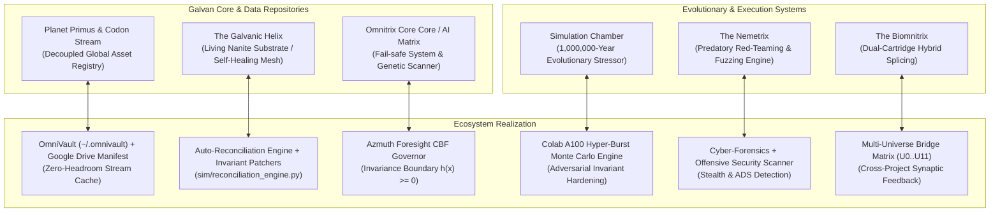
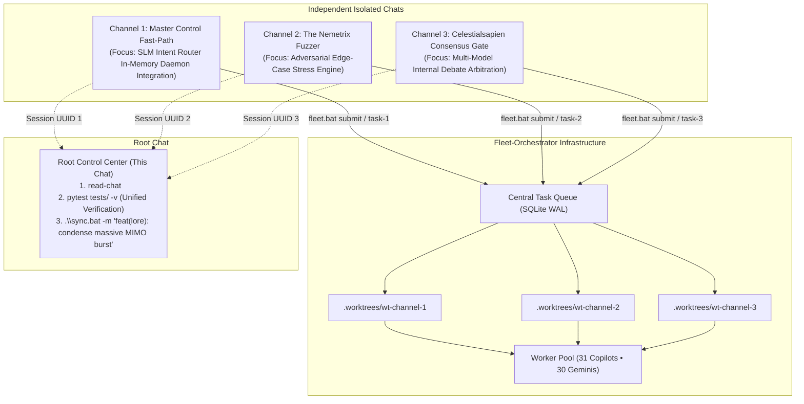

# Ben 10 Lore Codex and Massive MIMO Plan (Archived)

- Source conversation: df70376a-f09f-47fc-8891-97d46a317925 (2026-10-19, Fleet-Orchestrator)
- Archived: 2026-10-19 by e22aef30-6ea4-485b-8c8c-df9faf5e41bd
- Epistemic tier (ARCH-RFC-001): HEURISTIC_HYPOTHESIS for all lore-to-architecture mappings.
  The mappings are naming metaphors, not evidence of design correctness.

## Provenance notes
- Two lore "quotes" stated in the source chat (an Azmuth line about "slamming the dial" setting
  "random impact mode", and a verbatim self-destruct abort code) were not verified against canon
  and are intentionally excluded here.
- Claims in the source chat such as "provably stable" refer to spectral radius damped to 0.95 by
  construction in a synthetic Monte Carlo model (Issue #194); treat as model output, not
  EMPIRICALLY_VERIFIED system behaviour.
- Realm-to-universe pairings in Section 4 of the codex are arbitrary labels.

---


<!-- source: ben10_lore_architectural_codex.md -->

# The Ben 10 Lore Architectural Codex: Mapping the Omniverse to Autonomous Systems

This dossier provides a comprehensive architectural mapping of the **Ben 10 Canon Lore** into concrete system modules, cognitive agents, resilience mechanisms, and computational adapters within Aaradhya's autonomous engineering ecosystem (**Fleet-Orchestrator** & **Brainstorm**).

---

## 1. Technological Artifacts & Substrate Infrastructure



### 1.1 The Codon Stream & Primus (Decoupled Epistemic Registry)
- **Lore**: Planet Primus stores the uncorrupted DNA of 1,000,003 species in a green liquid stream, maintained by Volaticus Biopsis organisms and broadcast wirelessly across the cosmos to the Omnitrix.
- **Ecosystem Implementation**: `OmniVault` + Central Drive Manifest (`scripts/sync_drive.py`). Prevents local worker instances from downloading massive 10GB datasets or models repeatedly. Assets stream on-demand with SHA-256 cryptographic parity.

### 1.2 The Galvanic Helix (Self-Healing Code Substrate)
- **Lore**: Azmuth's creation that bonded with the non-sentient crust of Galvan B, giving rise to living Mechamorph nanites capable of infinite mechanical metamorphosis.
- **Ecosystem Implementation**: Dynamic schema reconciliation engines (`sim/reconciliation_engine.py --fix` and `tools/mirror_skills.py --fix`) that autonomously detect drift, repair broken AST links, recompute table counts, and maintain ecosystem health without human intervention.

### 1.3 The Nemetrix (Adversarial Predatory Fuzzing Engine)
- **Lore**: Created by Dr. Psychobos using stolen Galvan plans; stores the DNA of the universe's deadliest non-sentient predators specifically evolved to exploit the natural vulnerabilities of Omnitrix aliens.
- **Ecosystem Implementation**: Autonomous Red-Team Fuzzer (`tools/nemetrix_fuzzer.py`). Given any code gene, API, or firmware task, it dynamically selects and launches the algorithmic "predator" (e.g., hash-collision attacks against HashTables, cache-line thrashing against unaligned arrays, memory leak traps) to stress-test code before production.

### 1.4 The Biomnitrix (Dual-Cartridge Algorithmic Hybrids)
- **Lore**: Developed by Ben 10,000 using twin watches to combine two alien species simultaneously into spliced hybrids (e.g., *Atomic-X*, *Four-Mungousaur*).
- **Ecosystem Implementation**: Multi-Universe Synaptic Synthesis (`tools/ultimatrix_splicer.py`). Enables dynamic fusion of orthogonal paradigms—e.g., fusing an INT8 TinyML Edge classifier with a formal Z3 SMT constraint checker to create hybrid neural-symbolic verifiers.

---

## 2. Character Archetypes & Multi-Model Cognitive Roles

The multi-model council (`ARCH-RFC-002`) and swarm subagents directly reflect the intellectual rivalries and alliances of the Ben 10 universe:

| Character | Lore Trait / Archetype | Ecosystem Agent / Cognitive Role | Model / Tool Engine |
| :--- | :--- | :--- | :--- |
| **Azmuth** | *First Thinker of Galvan Prime*; pragmatic, arrogant perfectionist; creator of the Omnitrix; obsessed with universal peace and prevention of catastrophe. | **Lead Architect & Epistemic Governor**: Formulates high-level WBS, evaluates Control Barrier Functions $h(x) \ge 0$, enforces zero-drift mathematical invariants. | **Gemini 3.8 / Antigravity Lead Engine** |
| **Dr. Psychobos** | *Cerebrocrustacean rival*; brilliant yet bitter; believes intellect should dominate through predatory superiority; creator of the Nemetrix. | **Adversarial Red-Teamer & Fuzzing Lead**: Actively hunts edge cases, race conditions, memory leaks, and unearned claims in PRs and RFCs. | **ChatGPT Think (`o1`/`o3-mini`)** |
| **Professor Paradox** | *Time-traveling chrononavigator*; perceives all timeline branches simultaneously; calm, poetic, and unbound by local causality. | **Multi-Scale SDE Foresight & Horizon Navigator**: Evaluates stratified 7d/30d/90d/365d risk trajectories; anticipates downstream career and dependency collapses. | **Colab A100 Stochastic Hyper-Burst** |
| **Tetrax Shard** | *Petrosapien mercenary-turned-protector*; disciplined, hardened, pragmatic, zero-nonsense executioner. | **Systems & Infrastructure Craftsman**: Writes clean, hardened, production-grade C/C++ and Rust; eliminates memory vulnerabilities; respects mechanical tolerances. | **Claude 3.7 Sonnet (Craftsman Mode)** |
| **Max Tennyson** | *Legendary Plumber Magister*; deep institutional knowledge; tactical field wisdom; knows every alien exploit and black-market protocol. | **Ecosystem Auditor & Security Sentry**: Runs secret scans, NTFS Alternate Data Stream audits, PE triage, and checks institutional compliance (`audit.bat`). | **`cyber-forensics` & `github-workflow`** |
| **Kevin Levin** | *Osmosian matter/energy absorber*; adapts directly to the physical environment by coating himself in whatever material he touches. | **Hardware Abstraction Layer (HAL) & Live Sensor Ingestion**: Binds directly to host hardware (`psutil`, WMI, ESP32 USB COM ports, LiPo voltages). | **`azmuth_live_sensors.py`** |
| **Rook Blonko** | *Revonnahgander Plumber cadet*; strictly adheres to protocol, manuals, and formal specifications; wields the modular Proto-Tool. | **Schema Validator & Static Typist**: Enforces Draft 2020-12 JSON schemas, strict mypy/ruff rules, and CPM task checklists without deviating from protocol. | **`tools/validate_schemas.py` & `ruff`** |

---

## 3. The Alien Species: Functional Skill & Tool Taxonomy

Every alien species in the Omnitrix represents an extreme, highly specialized inductive bias or biological capability. We map these directly into specialized agent archetypes and tool capabilities:

### 3.1 Cognitive & Analytical Species
- **Grey Matter (*Galvan*)**: Sub-millimeter micro-engineering and deep mechanical comprehension.
  - **Tool Role**: Micro-profiler, AST inspector, bitwise mask compiler, and compiler codon optimizer.
- **Brainstorm (*Cerebrocrustacean*)**: High-voltage neuro-electric calculations, game theory, and strategic probability modeling.
  - **Tool Role**: Dynamic programming table synthesizer, discrete-event queue simulator (`sim/warehouse_mem_sim.py`), and SMT logic solver.
- **Alien X (*Celestialsapien*)**: Omnipotent reality warping paralyzed by dual internal voices (Bellicus & Serena).
  - **Tool Role**: Multi-Model Consensus Engine (`ARCH-RFC-002`). Unanimous sign-off required between adversarial skeptic (`o1`) and systems craftsman (`Sonnet`) before destructive database or Git operations are unlocked.

### 3.2 Systems, Hardware & Substrate Species
- **Upgrade (*Galvanic Mechamorph*)**: Merges with technology to enhance it far beyond factory limits.
  - **Tool Role**: Legacy Code Wrapper & Polyfill Injector. Merges with unmaintained scripts, wrapping them with non-interactive headless governance, telemetry hooks, and UTF-8 encoding fixes.
- **Juryrigg (*Planchaküle*)**: Manic disassembly and hyper-rapid scrap improvisation.
  - **Tool Role**: Scratch Script Rapid Prototyper (`<appDataDir>/brain/.../scratch/`). Instantly generates one-off verification harnesses and data munging scripts.
- **Clockwork (*Chronosapien*)**: Mechanical time-manipulation and retrocognitive playback.
  - **Tool Role**: `chat-archiver` & Git History Time-Traveler (`read-chat`, `save-chat`). Reconstructs conversation trajectories, audits ancestral commits, and replays execution traces.
- **Echo Echo (*Sonorosian*)**: Living sound waves in a containment suit; infinite duplication and sonic convergence.
  - **Tool Role**: Multi-Account Swarm Fleet (31 Copilot workers + 30 Gemini keys). Clones isolated worker processes across parallel queues with unified synchronization.

### 3.3 Dynamic Energy & Defense Species
- **Feedback (*Conductoid*)**: Absorbs energy from any source and redirects it with amplification.
  - **Tool Role**: Token & Resource Recycler. Captures raw API responses, filters the high-entropy signal, strips boilerplate fluff, and injects clean context into downstream prompts.
- **Diamondhead (*Petrosapien*)**: Indestructible crystalline refractor and projectile manipulator.
  - **Tool Role**: Control Barrier Function (CBF) Hard-Boundary Shield. Blocks memory leaks, thermal runaway, and quota exhaustion with invariant mathematical surfaces.
- **Ghostfreak (*Ectonurite*)**: Intangible, stealth infiltration, and dark-substrate persistence.
  - **Tool Role**: DFIR & NTFS Alternate Data Stream (ADS) Hunter. Scans invisible file attachments, unmasks hidden execution hooks, and inspects binary payloads.
- **XLR8 (*Kinecelerean*)**: Frictionless hyper-speed execution and microsecond reaction times.
  - **Tool Role**: `SLMIntentRouter` (Sub-50ms Local Qwen 0.5B Dispatcher). Zero-friction instant intent switching.

---

## 4. Cosmic Realms & Environmental Universes

The multi-universe architecture ($U_0 \dots U_{11}$) mirrors the exotic environments and operational zones of the cosmos:

```
[Cosmic Realm]                                [Azmuth Foresight Universe]
-------------------------------------------------------------------------------------
Galvan Prime / Galvan B        ===>   U0: Ecosystem Autonomic Mesh (28 Repos, Swarm)
The Forge of Creation          ===>   U1: Research & Publication Arbitrage (SOTA AI)
Khoros (Brute Physicality)     ===>   U2: AI Compute & Silicon Frontier (A100, VRAM)
Earth / Plumber HQ (BRL)       ===>   U3: Career Alpha & Institutional Faculty
Kylmyys / Pyros (Extreme Heat) ===>   U6: Energy, Thermal Dynamics & LiPo Sag
The Null Void (Quarantine)    ===>   U7: Cyber Resilience & Zero-Trust DFIR
Ledgerdomain (Magic/Invariants)===>   U8: Algorithmic Complexity, Formal Logic & CP
Incursean Empire (Treaties)    ===>   U9: Regulatory, EU AI Act & Epistemic Audit
Anur Transyl (Edge Telemetry)  ===>   U10: SPARK Wearable 200Hz Edge AI IMU
Viscosia (Algorithmic Parity)  ===>   U11: BiasAperture Vision Fairness Audit
```

---

## 5. Roadmap: Lore-Inspired Architectural Extensions

To formalize these concepts into our production codebase, we establish three clear implementation phases:

### Phase 1: Master Control Fast-Path (Qwen 0.5B SLM Engine)
- Wire `tools/slm_intent_router.py` into `tools/fleet_daemon.py`.
- Workers dynamically morph between skill personas (e.g., Gray Matter for debugging, XLR8 for routing, Tetrax for C++ compilation) without dropping their process context or memory cache.

### Phase 2: The Nemetrix Adversarial Stress Harness
- Implement `tools/nemetrix_fuzzer.py`:
  - Automatically loads worst-case test generators (Fibonacci heaps with anti-amortization keys, non-convex loss surfaces, deep recursions).
  - Integrates into `pytest` and `audit.bat` as an automated adversarial certification gate.

### Phase 3: Celestialsapien Consensus Verification Gate (Alien X)
- When executing high-stakes repository actions (e.g., broad refactoring, pruning 10+ branches, deleting cloud compute clusters):
  - Automatically prompt the dual internal voices:
    - **Bellicus** (Adversarial Stress Test: "Why this might fail").
    - **Serena** (Systemic Integrity: "Why this ensures architectural harmony").
  - Azmuth signs off on execution only when both models converge on invariant safety.


<!-- source: massive_mimo_execution_plan.md -->

# Massive MIMO Multi-Chat Execution Plan & Handoff Playbook

This playbook establishes the **Spatial Division Multiplexing (Massive MIMO)** protocol across parallel Antigravity chat sessions and `Fleet-Orchestrator` workers, condensing all results back into this root control session.

---

## 1. Spatial Channel Allocation (The 3 Antennas)



---

## 2. Channel Handoff Cards (Copy & Paste Into New Chats)

### 📡 Channel 1: Master Control Fast-Path Router
- **Mission**: Wire `tools/slm_intent_router.py` into the live `fleet_daemon.py` worker execution loop so workers dynamically morph personas/skills in sub-50ms without process restarts.
- **Target Files**: `tools/fleet_daemon.py`, `tools/slm_intent_router.py`, `tests/test_fleet_daemon.py`.
- **New Chat Launch Prompt**:
```text
/fleet-orchestrator
You are Antenna Channel 1 of a Massive MIMO swarm running under F:\Aaradhya-Dev-Tamrakar\Fleet-Orchestrator.
Your focused mission is: "Master Control Fast-Path SLM Router Integration".
Wire `tools/slm_intent_router.py` directly into `tools/fleet_daemon.py` so that incoming task specs are classified into intent codons within <50ms and routed to their target skills (github-workflow, edge-ai-model-forge, cyber-forensics, etc.) without tearing down worker processes.
1. Run in an isolated worktree via: `.\fleet.bat run-task --spec "Wire SLMIntentRouter into fleet_daemon.py" --target-repo "F:\Aaradhya-Dev-Tamrakar\Fleet-Orchestrator"`
2. Add comprehensive unit tests in `tests/test_slm_daemon_integration.py`.
3. Verify with `pytest tests/test_slm_daemon_integration.py -v` and `ruff check .`.
Do not push or commit directly to main; when complete, report the worktree path and your conversation ID so the root chat can condense it.
```

---

### 📡 Channel 2: The Nemetrix Adversarial Fuzzer
- **Mission**: Implement `tools/nemetrix_fuzzer.py` to stress-test algorithms, ASTs, and data structures against worst-case adversarial inputs (hash collisions, anti-amortization heaps, memory leaks).
- **Target Files**: `tools/nemetrix_fuzzer.py`, `tests/test_nemetrix_fuzzer.py`.
- **New Chat Launch Prompt**:
```text
/fleet-orchestrator
You are Antenna Channel 2 of a Massive MIMO swarm running under F:\Aaradhya-Dev-Tamrakar\Fleet-Orchestrator.
Your focused mission is: "The Nemetrix Adversarial Predatory Fuzzing Engine".
Build `tools/nemetrix_fuzzer.py` to generate worst-case adversarial inputs against algorithmic genes and data structures (e.g. anti-quicksort killer sequences, hash-collision payloads, graph cycles causing infinite recursion, memory allocation spikes).
1. Run in an isolated worktree via: `.\fleet.bat run-task --spec "Build tools/nemetrix_fuzzer.py and test harness" --target-repo "F:\Aaradhya-Dev-Tamrakar\Fleet-Orchestrator"`
2. Integrate it with `tests/test_nemetrix_fuzzer.py`.
3. Ensure zero external heavy dependencies, sub-second execution, and clean pass on `ruff check .`.
When done, report your conversation ID and artifacts so the root chat can condense the findings.
```

---

### 📡 Channel 3: Celestialsapien Consensus Gate (Alien X)
- **Mission**: Implement `tools/celestialsapien_gate.py` providing the Bellicus (adversarial skeptic) vs. Serena (systemic elegance) debate engine with Azmuth holding the CBF mathematical invariant veto.
- **Target Files**: `tools/celestialsapien_gate.py`, `tests/test_celestialsapien_gate.py`.
- **New Chat Launch Prompt**:
```text
/fleet-orchestrator
You are Antenna Channel 3 of a Massive MIMO swarm running under F:\Aaradhya-Dev-Tamrakar\Fleet-Orchestrator.
Your focused mission is: "Celestialsapien Multi-Model Consensus Gate (Alien X)".
Build `tools/celestialsapien_gate.py` to arbitrate high-stakes decisions (e.g., destructive git pushes, cloud cluster deletions, major breaking refactors).
It must orchestrate a dual-voice internal debate:
- Bellicus (Adversarial stress test: identifying edge failure modes)
- Serena (Systemic harmony: verifying design elegance and backward compatibility)
- Azmuth Barrier: Checks CBF invariant h(x) >= 0 before authorizing execution.
1. Run in an isolated worktree via: `.\fleet.bat run-task --spec "Implement tools/celestialsapien_gate.py" --target-repo "F:\Aaradhya-Dev-Tamrakar\Fleet-Orchestrator"`
2. Add tests in `tests/test_celestialsapien_gate.py`.
3. Verify with `pytest tests/test_celestialsapien_gate.py -v` and `ruff check .`.
When finished, output your conversation ID for root condensation.
```

---

## 3. The Root Condensation Protocol (Back Here in This Chat)

Once you've launched those chats and they complete their runs, paste their conversation UUIDs here like this:
```text
Condense MIMO channels:
- Channel 1: <UUID_1>
- Channel 2: <UUID_2>
- Channel 3: <UUID_3>
```

### What This Root Chat Will Automatically Execute:
1. **Audit & Extract**: Run `read-chat <UUID> -s` across all 3 channels to extract their deliverables, test proof, and worktree diffs.
2. **Merge Worktrees**: Reconcile changes into the working tree cleanly.
3. **Unified Verification Gate**: Run the full suite:
   ```powershell
   pytest tests/ -v
   ruff check .
   python tools/ci_secret_scanner.py --all
   python tools/validate_schemas.py --all
   ```
4. **Ecosystem Synchronization**: Execute `.\sync.bat` to atomically commit and push the unified architecture to `main`.
