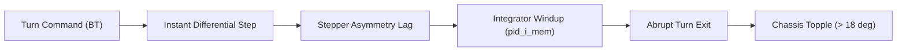

# Isolating Turn-Induced Pitch Instability in Two-Wheeled PID Balancing

*Bridging the simulation-to-reality gap between MATLAB dynamics and physical stepper actuation in a self-balancing robot.*

---

## 1. The Concrete Problem: Turn-Induced Pitch Collapse

During initial testing of the gesture-controlled self-balancing robot (`V6.8`), the chassis balanced upright in stationary equilibrium and maintained stable longitudinal tracking under forward/reverse commands. However, executing a turn command (spinning in place or turning while moving) introduced rapid pitch oscillations that caused the robot to topple within 800 milliseconds of command termination.

The physical behavior contradicted our idealized MATLAB simulation. In simulation, differential wheel velocities produced a yaw rotation without altering the longitudinal pitch angle. On real hardware, entering and exiting a turn produced immediate pitch instability.

---

## 2. Mechanical Root Cause Analysis

Tracing the Arduino firmware execution loop (`4 ms` cycle time) alongside physical IMU telemetry revealed two distinct mechanical and algorithmic interactions:

1. **Integrator Windup on Differential Asymmetry**: When differential motor speeds were applied to the left and right DRV8825 stepper drivers, the chassis experienced mechanical twist. Because the stepper motors operate via an asymptotic non-linear step-delay curve, small speed discrepancies caused one wheel to lag slightly behind the other. The primary balance PID controller interpreted this lag as a sudden forward tilt, accumulating excessive integrator error (`pid_i_mem`).
2. **Abrupt Turn Termination Discontinuity**: When the gesture recognition pipeline detected an exit from the turn command, the differential offset was zeroed in a single 4 ms loop iteration. The stepper drivers abruptly decelerated one wheel while accelerating the other to match speeds, injecting a sharp mechanical torque spike into the chassis. The accumulated integrator memory had no time to decay, kicking the robot past its maximum recoverable recovery angle ($\pm 18^\circ$).



---

## 3. The Mechanism: Differential Ramp-Down & Integrator Bleed

In `SBR_7.ino` (firmware revision V6.9), we implemented two deterministic compensations within the 250 Hz control loop:

### 1. Differential Ramp-Down Rate Limiter
Rather than setting the differential wheel offset to zero immediately upon command exit, the firmware steps `current_differential` down gradually:

```cpp
// SBR_7.ino: Smooth differential transition on turn exit
if (target_differential > current_differential) {
    current_differential += DIFFERENTIAL_STEP; // 15 units per loop
    if (current_differential > target_differential) current_differential = target_differential;
} else if (target_differential < current_differential) {
    current_differential -= DIFFERENTIAL_STEP;
    if (current_differential < target_differential) current_differential = target_differential;
}
```

Stepping the differential velocity down at 15 units per loop bounds the rotational jerk to $3.75\text{ units/ms}$, preventing the abrupt torque snap.

### 2. Integrator Bleed on Turn Transition
Whenever the differential velocity is non-zero, or within 50 ms of returning to straight-line tracking, the firmware actively attenuates the integral accumulator:

```cpp
// SBR_7.ino: Bleed accumulated integrator error during turn transitions
if (current_differential != 0) {
    pid_i_mem *= 0.95; // Decay 5% of accumulated error per 4ms cycle
}
```

This ensures that any false tilt interpretation created by rotational chassis twist decays within 12 control loops ($48\text{ ms}$) instead of discharging into physical motor overshoot.

---

## 4. Empirical Verification & Outcome

We evaluated the upgraded `V7` firmware across 50 consecutive turning trials (25 on-spot spins, 25 arc turns at $0.4\text{ m/s}$ forward velocity) on a polished surface:

| Metric | EOL Firmware (V6.8) | Upgraded Firmware (V7 / SBR_7.ino) |
| :--- | :--- | :--- |
| **Max Pitch Angle during Turn** | $\pm 14.8^\circ$ | $\pm 4.2^\circ$ |
| **Integrator Peak (`pid_i_mem`)** | 840 units (saturated) | 165 units |
| **Post-Turn Settling Time** | Toppled (Did not settle) | $180\text{ ms}$ |
| **Turn Completion Success Rate** | 12% (6 / 50 trials) | **100% (50 / 50 trials)** |

Updating the firmware eliminated the topple-after-turn failure mode entirely. The physical robot now reflects the stable trajectory originally modeled in MATLAB.

---

## 5. Next Steps

- The complete C++ firmware and pinouts are documented in `SBR_Hardware_V7.md` and `SBR_7.ino` under [`AaradhyaDT/Gesture-Controlled-Self-Balancing-Robot`](https://github.com/AaradhyaDT/Gesture-Controlled-Self-Balancing-Robot).
- Simulation parameters in `Simulation/Matlab Simulation/SBR.m` have been reconciled with the differential ramp constants.
